# Malvertising 1–3: From Ad to Payload

**CTF:** CTFkom
**Category:** Forensics / network analysis
**Tools:** Wireshark, dCode (JSFuck decoder)
**File:** `challenge.pcap` (renamed to `snorre.pcap` locally)

| Part | Name | Points | Solves |
|------|------|--------|--------|
| 1 | The First Redirect | 912 | 5 |
| 2 | The Browser Check | 912 | 5 |
| 3 | The Final Response | 950 | 4 |

---

## Overview

All three challenges use the same pcap and form a single malvertising chain. A victim visits a site, gets served an ad, and is pushed through a series of redirects. Along the way the browser is checked, and only a vulnerable target makes it all the way to the payload.

The full chain for the successful session:

```
news.example.test/article          (the site the victim visits)
  └─ ads.example.test/serve        (the ad)
       └─302→ click-gateway.test/r
               └─302→ traffic-router.test/visit
                       └─302→ browser-check.test/landing → /gate   ← browser check
                               └─302→ delivery-cache.test/fetch
                                       └─302→ asset-store.test/content   ← 200 OK, obfuscated JavaScript
```

Each session carries its own session ID in the `s=` parameter, which makes it easy to track a single client through the whole chain.

---

## Part 1: The First Redirect

> *Identify the destination domain of the first redirect in the malvertising chain.*

Since malvertising is all about pushing the victim to malicious domains, I started by looking at the DNS lookups:

```
dns
```

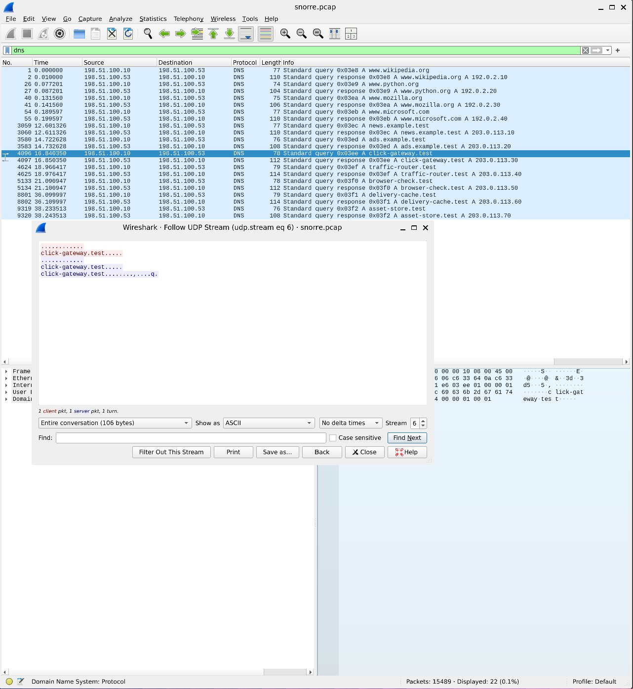

Besides normal traffic (wikipedia, python, mozilla, microsoft), a series of suspicious `.test` domains shows up in a clear order:

`news.example.test` → `ads.example.test` → `click-gateway.test` → `traffic-router.test` → `browser-check.test` → `delivery-cache.test` → `asset-store.test`

DNS gives a map of the domains, but it doesn't show who sends the victim where. Since the challenge asks about a *redirect*, I filtered on HTTP responses with status code 302:

```
http.response.code == 302
```

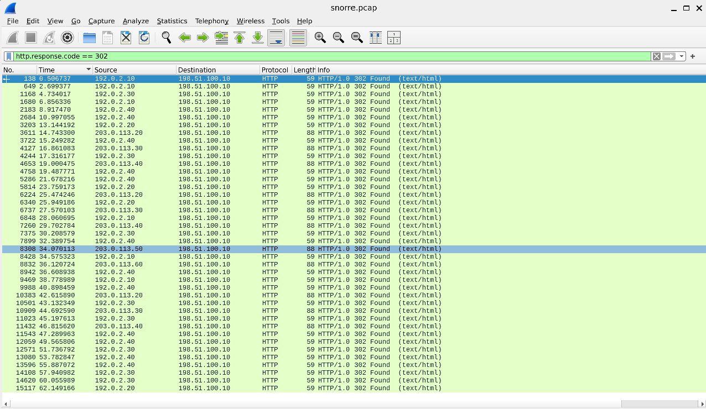

That gave a lot of noise. Most of the 302 responses come from `192.0.2.x`, which are the normal sites (wikipedia, python, mozilla, microsoft) with harmless `/out` redirects. According to the DNS answers, all the malvertising domains live in `203.0.113.0/24`, so I narrowed the filter and added the `Location` header as a column (right-click `Location` under *Hypertext Transfer Protocol* → **Apply as Column**):

```
http.response.code == 302 && ip.src == 203.0.113.0/24
```

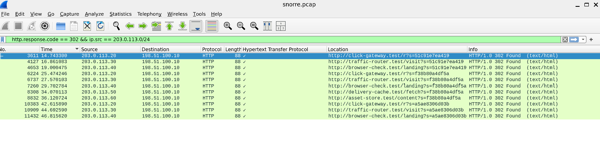

Now the entire redirect chain for all three sessions is visible in one list. The first redirect is packet **3611**, where `ads.example.test` (203.0.113.20) responds with:

```
Location: http://click-gateway.test/r?s=51c91e7ea419
```

So the ad sends the victim to `click-gateway.test`, which is the destination of the first redirect.

**Flag:** `CTFkom{click-gateway.test}`

---

## Part 2: The Browser Check

> *Investigate the browser check and recover the exact User-Agent that passes it.*

To see which browsers go through the chain, I filtered on requests to the first hop:

```
http.host == "click-gateway.test"
```

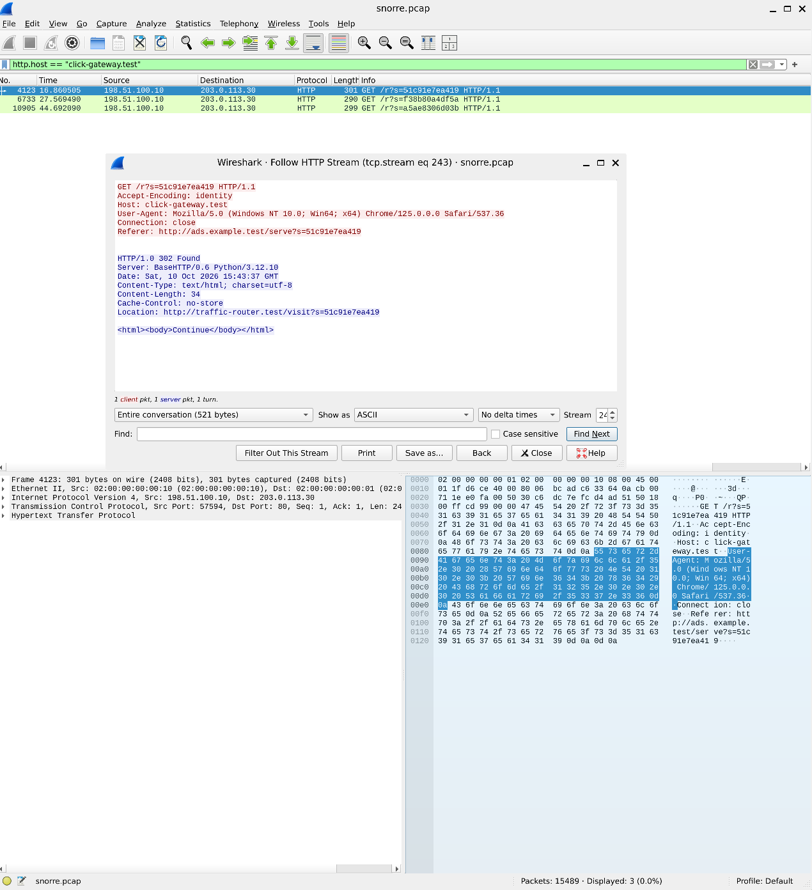

The three sessions hitting `click-gateway.test` each have their own session ID and User-Agent:

| Session ID | User-Agent |
|------------|------------|
| `51c91e7ea419` | Chrome 125 on Windows 10 |
| `f38b80a4df5a` | Internet Explorer 11 on Windows 7 |
| `a5ae8306d03b` | (third session) |

`click-gateway.test` treats them all the same and forwards them with `302 Found` to `traffic-router.test`. The filtering has to happen further down the chain.

To find where the sessions split, I used **Statistics → HTTP → Requests**, which groups all requests by host and URI:

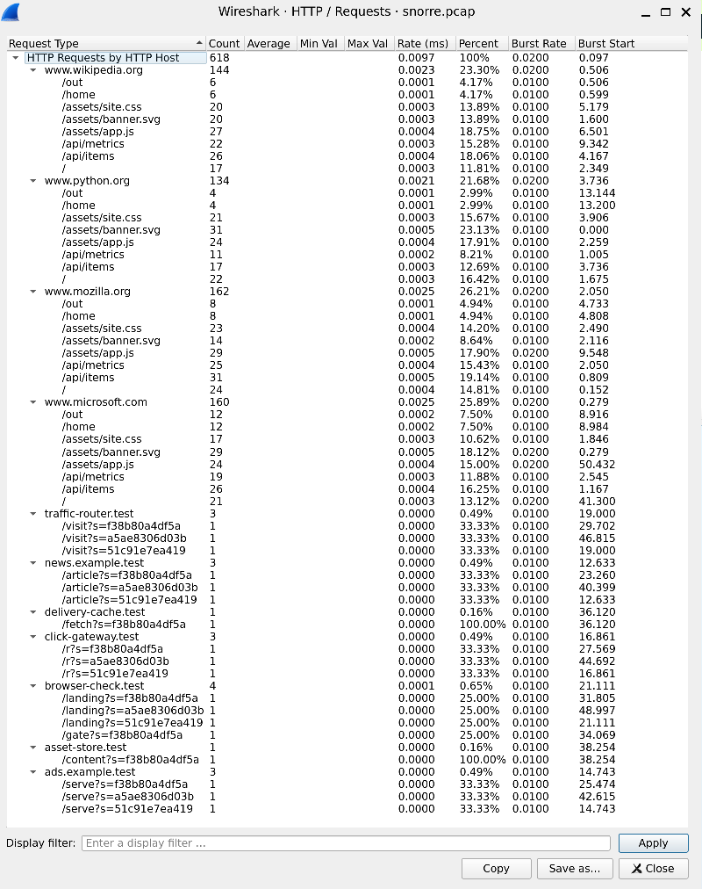

The overview clearly shows where the check kicks in:

| Host | `51c91e7ea419` | `f38b80a4df5a` | `a5ae8306d03b` |
|------|:-:|:-:|:-:|
| `news.example.test/article` | ✔ | ✔ | ✔ |
| `ads.example.test/serve` | ✔ | ✔ | ✔ |
| `click-gateway.test/r` | ✔ | ✔ | ✔ |
| `traffic-router.test/visit` | ✔ | ✔ | ✔ |
| `browser-check.test/landing` | ✔ | ✔ | ✔ |
| `browser-check.test/gate` | ✘ | ✔ | ✘ |
| `delivery-cache.test/fetch` | ✘ | ✔ | ✘ |
| `asset-store.test/content` | ✘ | ✔ | ✘ |

All three sessions reach `/landing`, but only `f38b80a4df5a` continues to `/gate` and the rest of the chain. The check must therefore be in the response from `browser-check.test/landing`.

### The check itself

To find it, I filtered on the `/landing` requests and followed the HTTP stream:

```
http.request.uri contains "/landing"
```

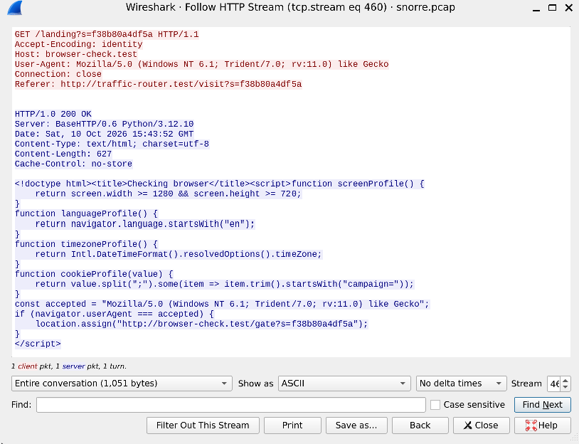

The response is `200 OK` with a small HTML page titled "Checking browser" that contains JavaScript. The important part is:

```js
const accepted = "Mozilla/5.0 (Windows NT 6.1; Trident/7.0; rv:11.0) like Gecko";
if (navigator.userAgent === accepted) {
    location.assign("http://browser-check.test/gate?s=f38b80a4df5a");
}
```

- The check runs **client-side, in the browser**. Only if `navigator.userAgent` is *exactly* equal (`===`) to the hardcoded string is the client sent on to `/gate`. Any other browser stays on the page, which is why the other two sessions stop here.
- The functions `screenProfile`, `languageProfile`, `timezoneProfile` and `cookieProfile` are defined but never called. They are decoys that make the check look like more advanced fingerprinting than it really is.

The session with the matching User-Agent is the IE11 session:

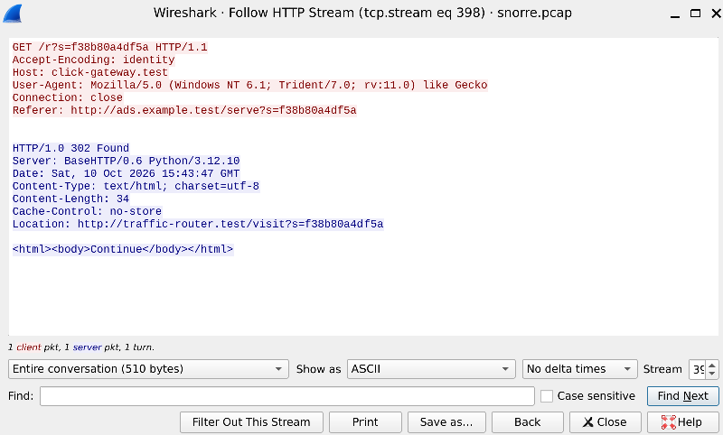

**Why IE11 on Windows 7?**

- `Windows NT 6.1` is Windows 7 and `Trident/7.0; rv:11.0` is Internet Explorer 11, both outdated and no longer receiving security updates.
- Real exploit kits (e.g. RIG and Magnitude) have long targeted Internet Explorer vulnerabilities, such as the VBScript bug CVE-2018-8174.
- By only delivering the payload to vulnerable browsers, the attacker avoids exposing the infrastructure to security researchers, crawlers and sandboxes running modern browsers. This technique is called *cloaking*.

**Flag:** `CTFkom{Mozilla/5.0 (Windows NT 6.1; Trident/7.0; rv:11.0) like Gecko}`

---

## Part 3: The Final Response

> *Follow the successful session and uncover its final secret.*

The successful session is the IE11 session with session ID `f38b80a4df5a`. I followed it hop by hop with *Follow → HTTP Stream*, using the `Location` header of each response to find the next one.

### Hop 1: traffic-router.test

`GET /visit?s=f38b80a4df5a` returns `302 Found` with `Location: http://browser-check.test/landing?s=f38b80a4df5a`.

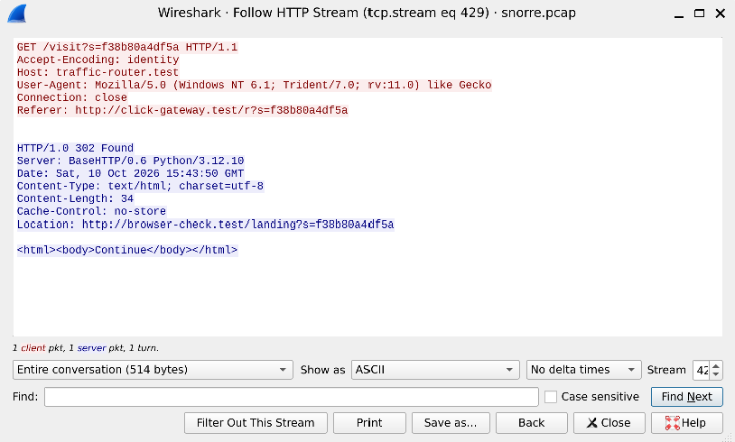

### Hop 2: browser-check.test

The browser check consists of `/landing` followed by `/gate`. For the IE11 session, `/gate` responds with `302 Found` and `Location: http://delivery-cache.test/fetch?s=f38b80a4df5a`. The victim has passed the check.

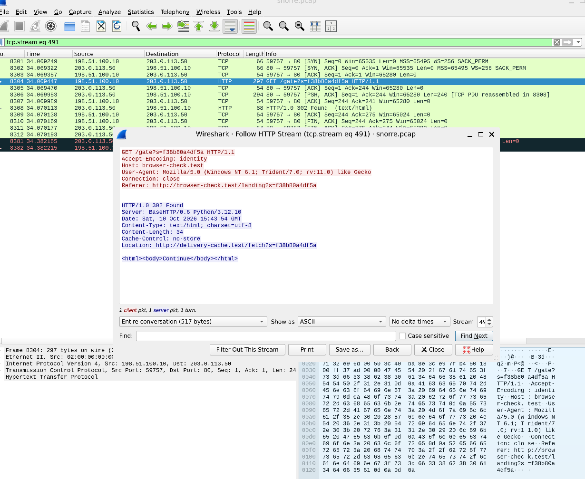

### Hop 3: delivery-cache.test

`GET /fetch?s=f38b80a4df5a` redirects to `http://asset-store.test/content?s=f38b80a4df5a`.

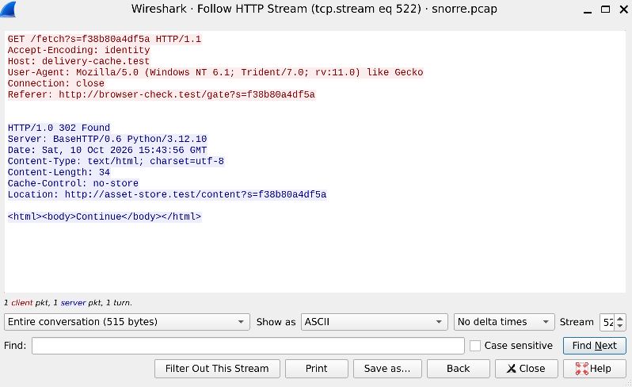

All redirect responses so far have the same tiny HTML body (`Continue`) and `Cache-Control: no-store`, so there's nothing hidden in them. The `Location` header is what drives the chain forward.

### Final response: asset-store.test

This is where the chain ends. Instead of another redirect, the server returns `HTTP/1.0 200 OK` with `Content-Type: application/javascript` and a ~54 kB body consisting only of the characters `[ ] ( ) ! +`.

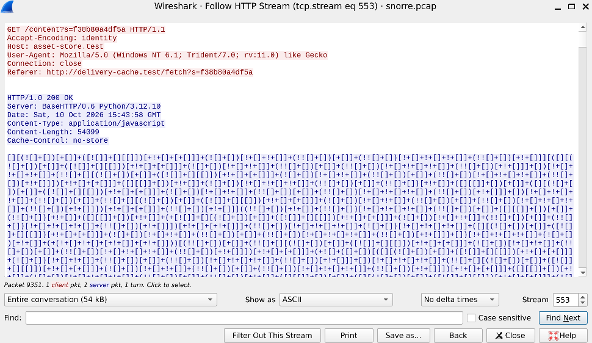

This is **JSFuck**, an obfuscation technique that writes valid JavaScript using only six characters. Attackers use it to make code unreadable and to evade signature-based detection.

I copied the code and decoded it with dCode's JSFuck decoder in **"Display as JavaScript"** mode. That mode shows the code without executing it, which matters when handling potentially malicious code.

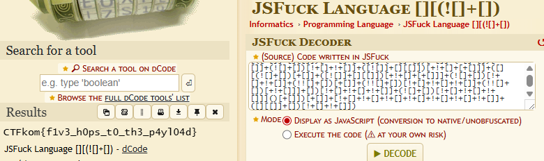

**Flag:** `CTFkom{f1v3_h0ps_t0_th3_p4yl04d}`

The flag matches the chain: from the ad there are exactly five redirects (click-gateway → traffic-router → browser-check → delivery-cache → asset-store) before the payload is delivered.

---

## Indicators of Compromise (IOCs)

| Type | Value |
|------|-------|
| Domain | `ads.example.test` (203.0.113.20) |
| Domain | `click-gateway.test` (203.0.113.30) |
| Domain | `traffic-router.test` (203.0.113.40) |
| Domain | `browser-check.test` (203.0.113.50) |
| Domain | `delivery-cache.test` (203.0.113.60) |
| Domain | `asset-store.test` (203.0.113.70) |
| Victim | 198.51.100.10 |
| Server banner | `BaseHTTP/0.6 Python/3.12.10` |
| Targeted UA | `Mozilla/5.0 (Windows NT 6.1; Trident/7.0; rv:11.0) like Gecko` |

---

## Takeaways

- **Map first, then confirm.** DNS gave an overview of the domains; the 302 filter proved the actual order of the redirects.
- **Filter out the noise.** Narrowing on the suspicious IP range turned dozens of irrelevant redirects into a clean chain.
- **Follow the session ID.** The `s=` parameter made it possible to isolate one client across every hop.
- **Cloaking is common.** Real malvertising campaigns filter victims by browser, OS, IP and geography to hide from researchers.
- **Don't run unknown JavaScript.** Decode obfuscated code statically instead of executing it.
- **Many hops are a hallmark.** Long redirect chains make the infrastructure harder to trace and block, and each link can be swapped out independently.
